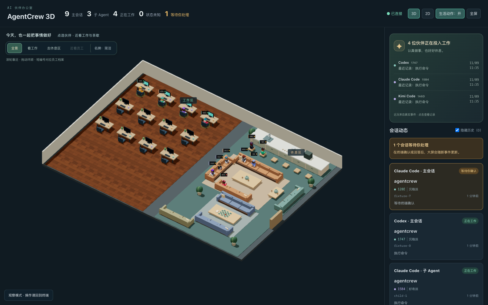

# AgentCrew 3D

**把终端里的 AI Agent，变成办公室里的伙伴。**

AgentCrew 3D 是基于 [Hermes3D](https://github.com/iamlukethedev/Hermes3D) 二次开发的本地只读观察室：工作中的 Agent 坐在电脑前，空闲的伙伴去共享沙发、茶水间和桌游区；需要你确认时，大屏提醒你回到终端处理。



*截图使用隔离模拟数据演示工作、休息与等待状态，不包含真实会话。*

[快速开始](#快速开始) · [Hook 接入](docs/integrations/local-observer.md) · [版本记录](docs/releases.md) · [来源与许可证](#来源与许可证)

> 开发预览 `0.1.0-dev.5`。办公室动作是状态的拟人化表现，不表示 Agent 的真实身体活动、内部思考或绩效。

## 能看到什么

- **工作与休息**：规整的独立工位、亮屏电脑，以及共享沙发、茶水台和实体桌游；休息区没有电脑。
- **真实状态提醒**：工作、等待处理、回合结束、错误／中断、状态未知分别展示。没有新事件不等于任务完成。
- **多工具与子 Agent**：接收 Codex、Claude Code、Kimi Code 的 Hook 和 DSH 的原生插件事件；有可靠身份与生命周期证据时，单独显示子 Agent 和父子关系。
- **办公室生活感**：打字、查看屏幕、举杯、看棋等小动作，可关闭，并尊重系统减少动态偏好。
- **近距离看伙伴**：全景、工作区、休息区、员工近景；手动拖动后保持自由视角。短编号、详细名牌和员工档案帮助识别伙伴。
- **3D / 2D**：可切换低负担的像素办公室；新增近景镜头仅用于 3D。
- **局域网大屏**：可选择无口令、仅开放观察功能的局域网模式。

## 观察室的边界

`/observe` 不连接模型、不派发任务、不回答问题、不代替你批准操作。需要确认或继续时，请回到对应终端或 DSH 界面。

界面只展示状态元数据，例如工具名称、会话／子 Agent ID、项目路径、事件类型和时间；不展示提示词、命令参数、工具输出或完整对话。Codex 兼容校正会在本机有界读取**已知会话**文件尾部，只提取白名单生命周期元数据，不保存或传输正文。

**原 Hermes3D Studio / Gateway 功能仍保留在代码中，具有独立的交互和权限范围。** “只读”描述的是观察模式，并非整个上游 Studio。`--observe-public` 会阻止远程访问 Studio、其他 API、控制请求及 WebSocket。

## 快速开始

需要 Node.js 20+、npm 10+。安装 Hook 另需 Python 3.11+，无需额外 Python 包。观察模式不需要 Hermes 后端、模型 API Key、数据库或 Docker。

```sh
git clone https://github.com/heyaohua/agentcrew-3d.git
cd agentcrew-3d
npm ci
npm run observe
```

打开 **[http://127.0.0.1:3000/observe](http://127.0.0.1:3000/observe)**。初次没有会话是正常现象，需要安装 Hook 并收到工具事件。开发服务器的首次页面编译可能需要等待。

在另一个终端，为需要观察的工具安装 Hook：

```sh
python3 scripts/observer-hooks.py install --tool codex
python3 scripts/observer-hooks.py install --tool claude
python3 scripts/observer-hooks.py install --tool kimi
# DeepSeek Harness 桌面版使用原生只读插件
python3 scripts/dsh-observer.py install --profile desktop
```

DSH 插件监听原生回合、工具、批准和子 Agent 事件，不扫描历史对话。配置热加载与版本限制见 [DSH 接入说明](docs/integrations/dsh-observer.md)。

只安装你使用的工具即可。安装器备份现有配置并追加自己的 Hook，不覆盖其他 Hook。已启动的 Agent 可能需要重新加载配置或重启；Codex 还可能要求在其 Hook 管理界面审阅信任。**查看页面、升级前端或重启观察服务本身，不要求重启 Agent。**

脚本路径会写入 Hook 配置，移动项目后需重新安装。卸载、状态含义、兼容限制见 [完整接入说明](docs/integrations/local-observer.md)。

### 生产方式运行

```sh
npm run build -- --webpack
npm run start -- --observe
```

同样打开 `http://127.0.0.1:3000/observe`。构建使用 Google Fonts，需要网络访问。可通过 `HERMES_DIST_DIR` 将新版本构建到独立目录，验证后再切换服务，避免构建时覆盖正在使用的静态资源。

### 局域网大屏

先完成生产构建，再运行：

```sh
HOST=0.0.0.0 PORT=5297 npm run start -- --observe --observe-public
```

- 本机固定入口：`http://127.0.0.1:5297/observe`。
- 同一局域网其他设备：`http://<运行服务的电脑当前局域网IP>:5297/observe`。
- 换网络后 IP 可能改变。本机收藏 `127.0.0.1` 即可避免这个问题。
- 此模式无查看口令；能连接端口的人可以看到状态和项目路径。适用于可信局域网，不要直接映射到公网。
- Hook 事件仍只能通过本机回环地址和独立令牌提交；远程查看者不能控制 Agent。

这些环境变量示例适用于 macOS / Linux shell。Windows 可在 PowerShell 中先设置对应的 `$env:HOST`、`$env:PORT`。

### 数据存在哪里

为兼容已有安装，默认仍使用 `~/.hermes3d-observer`。可用 `OBSERVER_STATE_DIR` 指定目录；安装 Hook 时也须通过 `--state-dir` 指向同一目录。状态文件、接收令牌、Hook 备份和 `.env` 都属于本机私有文件，不要提交到 GitHub。

## 支持范围与限制

| 工具 | 观察方式 | 注意事项 |
| --- | --- | --- |
| Codex | Hook + 已知会话的本机生命周期校正 | 需要受支持的 Hook 版本及信任配置；旧进程可能缓存旧 Hook |
| Claude Code | 会话、工具、等待及子 Agent Hook | 依赖实际产生的事件及子 Agent 标识 |
| Kimi Code | 已支持的会话 Hook | 不假定所有版本均提供相同子 Agent 生命周期事件 |
| DSH / DeepSeek Harness | 原生 Cordis 只读插件 | 按桌面版 `0.2.1-rc.5` 事件契约适配；需加载插件并产生新事件，不回放历史 |

未知／失联记录只保留最后状态，不虚构工作或休息人物。Stop 表示一轮结束，不等于项目成功或验收通过。主 Agent 和子 Agent 分开计数，子 Agent 的活动不会冒充主 Agent 正在执行。

当前验证包含状态／接收器／Hook 辅助程序测试、隔离模拟场景、可见浏览器和本机局域网访问。**模拟事件测试不等于所有工具全部版本的真实审批闭环验证**；实体手机和长时间运行也不是已完成的兼容承诺。具体范围见 [版本记录](docs/releases.md)。

## 开发与验证

```sh
npm run typecheck
npm run test:observer
python3 -m unittest discover -s tests/observer -p 'test_*.py'
npx vitest run tests/unit/observer*.test.ts
npm run build -- --webpack
```

`npm run lint` 和完整 `npm run test -- --run` 可检查上游全部功能；历史完整套件存在已记录失败，不以局部测试通过代替全项目通过。

- [贡献说明](CONTRIBUTING.md)
- [安全与隐私](SECURITY.md)
- [上游 Hermes3D README](README.hermes3d.md)：原 Studio、运行时、Gateway 和演示功能
- [上游架构文档](ARCHITECTURE.md)：不代表观察模式需要部署对应后端

Docker 发布工作流保留为手动触发，推送源码不会自动发布容器镜像。容器中的回环地址与宿主机不同，当前终端 Hook 推荐直接在本机运行观察器。

## 来源与许可证

AgentCrew 3D 是独立维护的二次开发项目，不是 Hermes3D 官方更名，也不代表原作者或各 Agent 工具厂商。

- **原项目**：[iamlukethedev/Hermes3D](https://github.com/iamlukethedev/Hermes3D)
- **原作者**：Luke The Dev（[@iamlukethedev](https://github.com/iamlukethedev)）
- **上游基线**：[`beb7629`](https://github.com/iamlukethedev/Hermes3D/commit/beb7629)
- **二次开发维护**：[@heyaohua](https://github.com/heyaohua)
- **许可证**：[MIT](LICENSE)，原始 `Copyright (c) 2026 Luke The Dev` 和许可文本完整保留；本项目修改同样采用 MIT。

感谢 Hermes3D 提供 3D / 2D 办公室、人物与场景、Studio 及 Gateway 基础。AgentCrew 3D 在此基础上增加本地终端观察、状态可信度处理、共享休息区、生活动作与员工近景等功能。依赖与第三方素材仍适用各自许可证；来源说明见 [NOTICE](NOTICE.md)。
